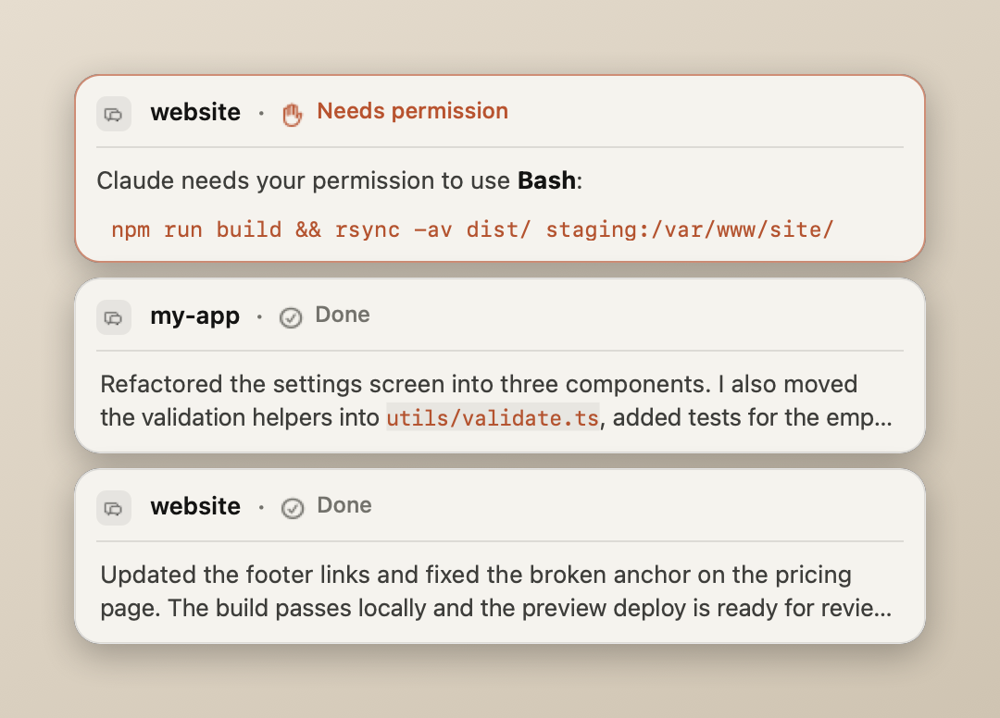
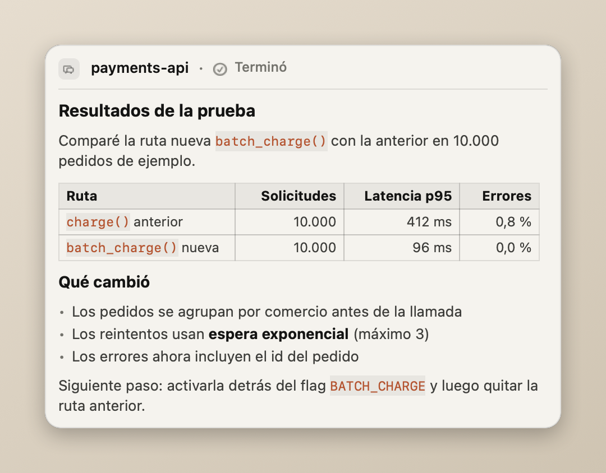
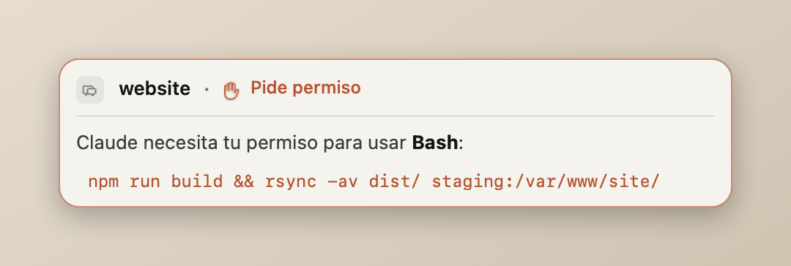
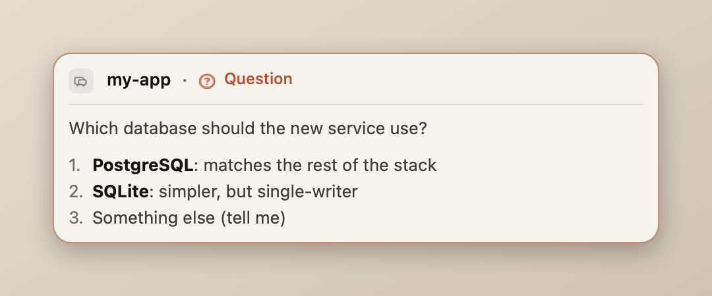
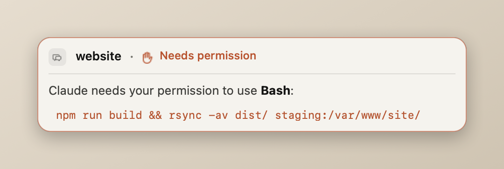
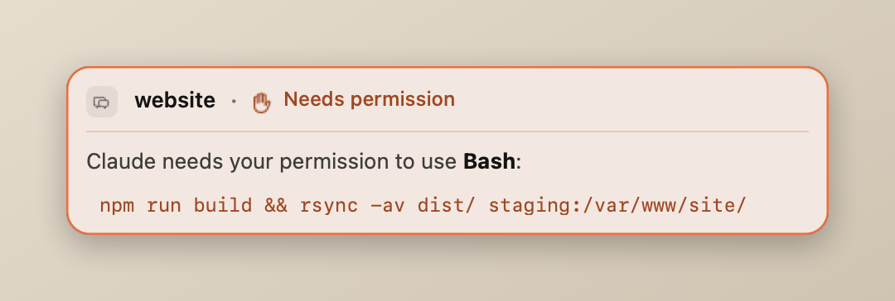
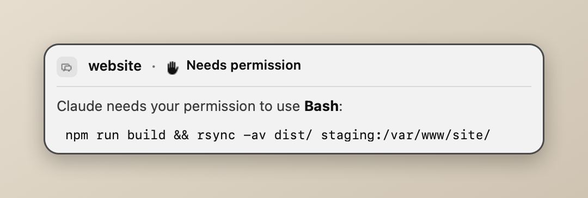
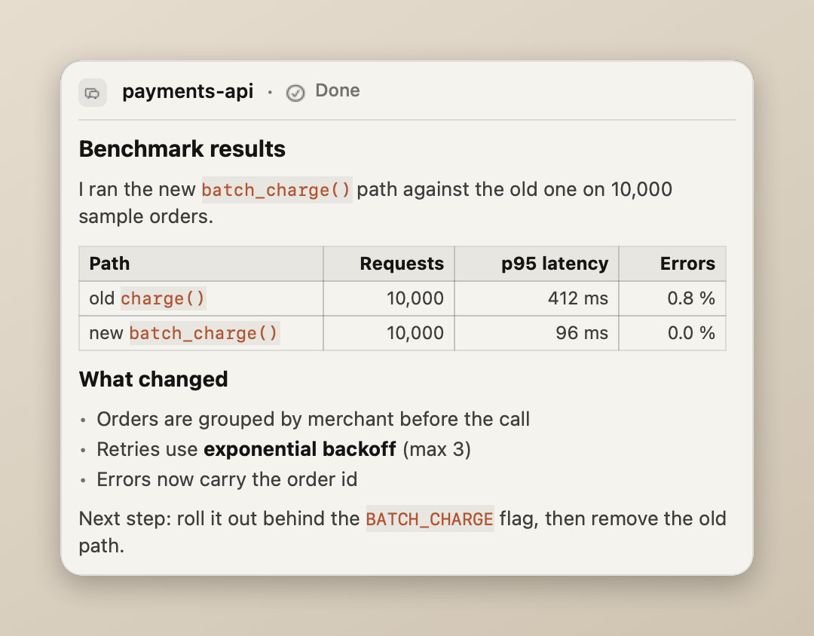
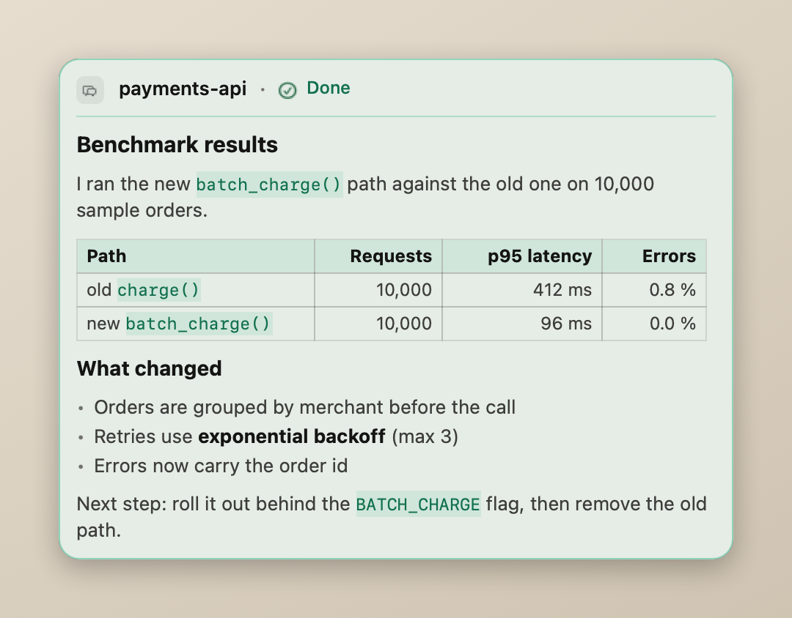
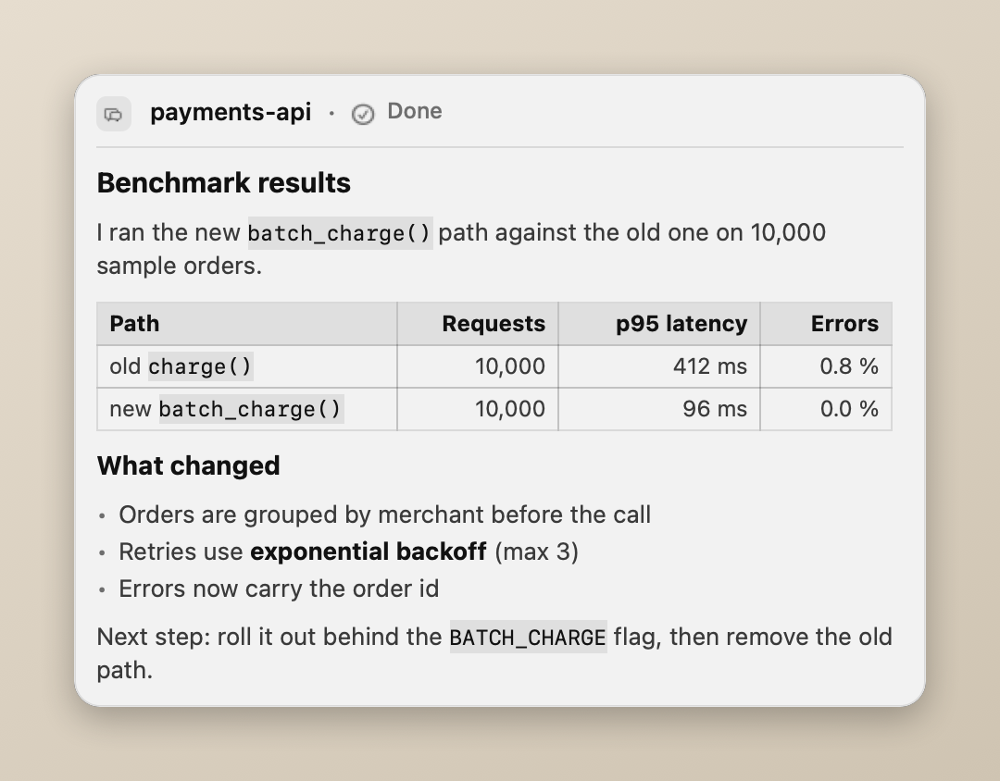

# Avisos de Claude Code para VS Code en macOS

**[English](README.md)**

Avisos en pantalla, un monitor de sesiones en la barra de menú, sonidos por tipo de mensaje y una línea de estado
minimalista para **[Claude Code](https://docs.claude.com/en/docs/claude-code) en la terminal de VS Code, en macOS**.
Cuando Claude termina o necesita tu permiso, aparece una tarjeta con su último mensaje, con Markdown de verdad:
tablas, código y listas. Si la tocas, llegas a **la terminal exacta de VS Code** donde corre esa sesión.

Está hecho solo con los [hooks](https://docs.claude.com/en/docs/claude-code/hooks) de Claude Code y un script de
[línea de estado](https://docs.claude.com/en/docs/claude-code/statusline). Todo es local: sin cuentas, sin servidor
y sin telemetría.

> Proyecto de la comunidad, no oficial. No está afiliado a Anthropic ni cuenta con su aval. "Claude" es una marca de Anthropic.

<p align="center">
  <picture><source media="(prefers-color-scheme: dark)" srcset="docs/img/popup-stack-dark.png"></picture>
</p>

## Capturas

Cada tipo de mensaje tiene su ícono y su etiqueta. Los que te necesitan llevan color y un borde fino completo, y se
quedan hasta que respondes. (Las imágenes siguen el tema claro u oscuro de tu GitHub.)

| Terminó (con una tabla) | Pide permiso |
|---|---|
| <picture><source media="(prefers-color-scheme: dark)" srcset="docs/img/popup-table-es-dark.png"></picture> | <picture><source media="(prefers-color-scheme: dark)" srcset="docs/img/popup-permission-es-dark.png"></picture> |
| **Pregunta** | **Un agente en segundo plano pregunta** |
| <picture><source media="(prefers-color-scheme: dark)" srcset="docs/img/popup-style-default-question-dark.png"></picture> | <picture><source media="(prefers-color-scheme: dark)" srcset="docs/img/popup-style-default-agent-dark.png"></picture> |

### Tres estilos

Elige uno con `"popup": { "style": "default" }` en la configuración.

| `default` | `color` | `mono` |
|---|---|---|
| <picture><source media="(prefers-color-scheme: dark)" srcset="docs/img/popup-style-default-permission-dark.png"></picture> | <picture><source media="(prefers-color-scheme: dark)" srcset="docs/img/popup-style-color-permission-dark.png"></picture> | <picture><source media="(prefers-color-scheme: dark)" srcset="docs/img/popup-style-mono-permission-dark.png"></picture> |
| <picture><source media="(prefers-color-scheme: dark)" srcset="docs/img/popup-style-default-done-dark.png"></picture> | <picture><source media="(prefers-color-scheme: dark)" srcset="docs/img/popup-style-color-done-dark.png"></picture> | <picture><source media="(prefers-color-scheme: dark)" srcset="docs/img/popup-style-mono-done-dark.png"></picture> |

- **default**: tarjeta neutra y tranquila; solo los mensajes que te necesitan llevan el color de atención.
- **color**: un color por tipo: verde terminó, naranja permiso, azul pregunta, violeta agente.
- **mono**: solo grises; lo urgente se nota por el ícono relleno, la etiqueta en negrita y un borde más marcado.

Más: los mensajes largos tienen scroll y los avisos anteriores se achican a dos líneas. Mira la **[galería completa](docs/gallery.md)**.

## Qué incluye

| Pieza | Qué hace |
|---|---|
| **Aviso** | Una tarjeta translúcida arriba a la derecha cuando Claude **termina**, **pide permiso**, **hace una pregunta** o un **agente en segundo plano** te necesita. Muestra el mensaje con formato (títulos, negritas, `código`, listas, tablas de verdad) y tiene scroll si es largo. Cada tipo tiene su ícono y su etiqueta. Los que te necesitan se quedan hasta que respondes; los de "terminó" se van a los 60 s (la cuenta se pausa si tienes el mouse encima o no estás frente a la compu). |
| **Ir a la terminal** | Al tocar un aviso, o una sesión en la barra de menú, la ventana correcta de VS Code pasa al frente y se muestra **la terminal exacta** de esa sesión. Funciona con VS Code, Insiders, Cursor, Windsurf y VSCodium. |
| **Barra de menú** | Un ícono que te dice de un vistazo si alguna sesión te necesita, te escribió (sin leer) o está pensando. El menú lista cada sesión con su proyecto y su estado. |
| **Sonidos por tipo** | Un sonido distinto para terminó, permiso, pregunta y agente. El de "terminó" solo suena si la tarea tardó y no estás mirando VS Code. Con horas de silencio, sonidos propios y como máximo un sonido cada 3 s. |
| **Línea de estado** (opcional) | Una sola línea gris: proyecto · modelo · % de contexto · costo de la sesión · límites de 5 horas y de la semana. El color aparece solo arriba del 40 %. |

## Requisitos

- macOS 12 Monterey o más nuevo (Intel o Apple Silicon)
- Herramientas de línea de comandos de Xcode (`xcode-select --install`), que traen `swiftc`, `python3` y `git`
- Claude Code, usado desde la **terminal integrada** de VS Code (o Insiders, Cursor, Windsurf o VSCodium)

¿Recién empiezas con todo esto? Sigue la guía paso a paso: **[Instalar Claude Code en una Mac](docs/install-claude-code-mac.es.md)**.

## Instalar

```bash
git clone https://github.com/Migentetamoenjapon/claude-code-vscode-notifications.git
cd claude-code-vscode-notifications
./install.sh              # agrega --statusline para instalar también la línea de estado
```

El instalador:

1. Compila las dos apps en tu Mac a partir del código, sin binarios descargados, así que macOS no muestra advertencias.
2. Copia todo a `~/.claude/ccnotify/`.
3. **Agrega** sus hooks a `~/.claude/settings.json`. Los hooks que ya tengas se quedan, y antes guarda un respaldo con fecha.
4. Hace que la app de la barra de menú arranque al iniciar sesión (con un LaunchAgent).
5. Instala la extensión "Focus Terminal" en cada editor de la familia VS Code que encuentre.

Opciones útiles: `--dry-run` (muestra lo que haría), `--statusline`, `--force` (reemplaza una línea de estado que ya
tengas) y `--universal` (compila para Intel y Apple Silicon). Después, reinicia tus sesiones de Claude Code para que
carguen los hooks.

## Configurar

Edita `~/.claude/ccnotify/config.json`. Todas las claves son opcionales; mira [`config.example.json`](config.example.json).

```json
{
  "language": "es",
  "popup": { "seconds": 60, "width": 460, "max_height_ratio": 0.6, "font_size": 13,
             "sticky_needs_you": true, "private": false,
             "style": "default", "compact_lines": 2 },
  "sounds": {
    "done":       { "sound": "Glass",     "volume": 0.5, "only_when_away": true, "min_turn_seconds": 15 },
    "permission": { "sound": "Submarine", "volume": 0.8 },
    "question":   { "sound": "Ping",      "volume": 0.8 },
    "agent":      { "sound": "Purr",      "volume": 0.7 }
  },
  "quiet_hours": { "enabled": false, "from": "22:00", "to": "07:00" },
  "events": { "done": true, "permission": true, "question": true, "agent": true }
}
```

- **`style`**: `default`, `color` o `mono` (mira las capturas de arriba). **`compact_lines`**: cuántas líneas conservan los avisos anteriores de la pila (2 por defecto).
- **`language`**: `auto` (sigue el idioma de macOS), `en` o `es`.
- **Sonidos**: cualquier nombre de `/System/Library/Sounds` (Basso, Blow, Bottle, Frog, Funk, Glass, Hero, Morse, Ping,
  Pop, Purr, Sosumi, Submarine, Tink), un archivo que pongas en `~/Library/Sounds`, la ruta completa a un archivo de
  audio, o `""` para que no suene.
- **`private`**: muestra solo el proyecto y el tipo de mensaje, nunca el texto. Sirve para cuando presentas.
  Además, los avisos no aparecen al compartir pantalla.
- **`events`**: apaga por completo los avisos de un tipo.

Los cambios se aplican desde el siguiente aviso, sin reiniciar nada.

## Línea de estado

`./install.sh --statusline` la configura. Qué significa cada parte y sus opciones (el precio de tu plan para ver
dólares, y un ticker de mercado opcional, apagado de fábrica y lo único que usa internet):
**[docs/statusline.es.md](docs/statusline.es.md)**.

## Privacidad y permisos

- Todo corre en tu Mac. No se envía nada a ningún lado.
- Para decidir cuándo avisar, el hook lee el **final** del historial de la sesión que Claude Code ya guarda en
  `~/.claude/projects/`. El aviso muestra el último mensaje de Claude, y la barra de menú guarda un resumen de una
  línea por cada sesión abierta.
- Se guarda en `~/.claude/ccnotify/state/` con permisos privados (carpetas 0700, archivos 0600). Los avisos en cola
  se borran al mostrarse, y cualquier cosa de más de una hora se limpia. El registro nunca incluye el texto de los mensajes.
- No pide permisos especiales de macOS: ni Accesibilidad, ni Grabación de pantalla, ni Automatización.

## Desinstalar

```bash
./uninstall.sh            # quita los hooks, la línea de estado (si es la nuestra), las apps, el LaunchAgent y la extensión
./uninstall.sh --purge    # además borra ~/.claude/ccnotify (configuración y estado)
```

## Si algo no funciona

- **No aparece ningún aviso**: reinicia tus sesiones de Claude Code, porque los hooks se cargan al empezar. Después mira
  `~/.claude/ccnotify/state/ccnotify.log`, donde queda cada decisión (sin el texto de los mensajes).
- **El clic no llega a la terminal**: la extensión "Focus Terminal" tiene que estar activa en ese editor
  (Extensiones → busca `ccnotify`). Si instalas un editor nuevo, vuelve a correr `./install.sh`.
- **Usas Claude desde el panel de Claude Code de VS Code, no desde una terminal**: los avisos y sonidos funcionan; el
  clic trae la ventana, pero no hay terminal que seleccionar.
- **Suena demasiado**: sube `sounds.done.min_turn_seconds`, pon `"sound": ""` en un tipo o activa `quiet_hours`.

## Cómo funciona

Cinco hooks de Claude Code llaman a un script pequeño de Python, que decide si avisar y escribe un archivo JSON; una
app nativa en Swift lo muestra. Detalles, archivos y decisiones de diseño (en inglés):
**[docs/ARCHITECTURE.md](docs/ARCHITECTURE.md)**.

## Colaborar

Los issues y pull requests son bienvenidos. Corre las pruebas con `python3 -m unittest discover -s tests` y genera las
capturas de ejemplo con `tests/render/render_samples.sh`. La idea es que siga sin dependencias y todo local.

## Licencia

[MIT](LICENSE)
