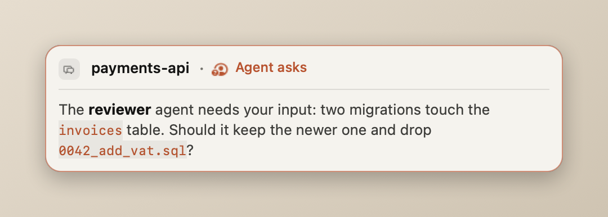
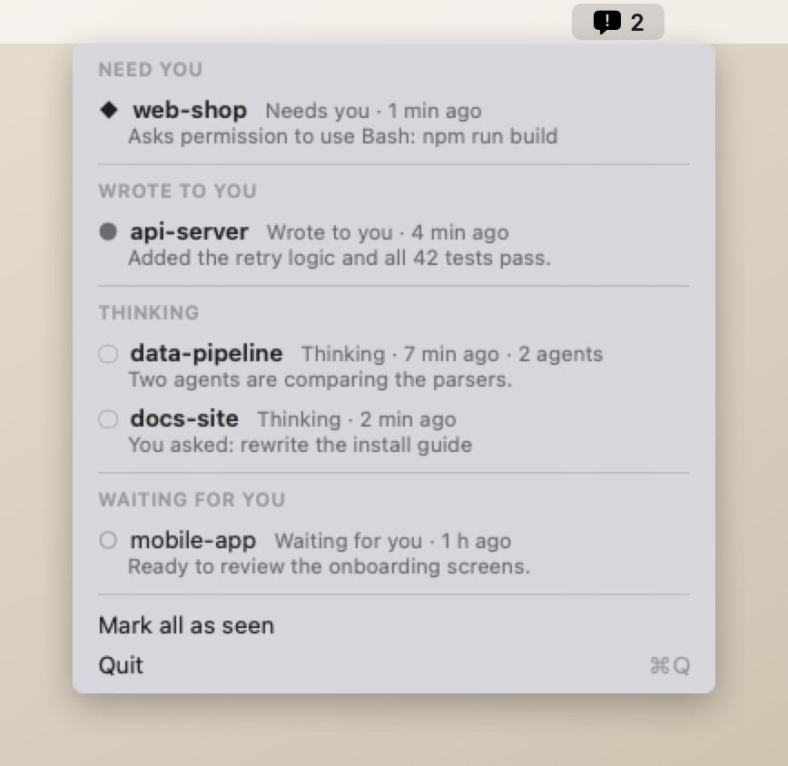

# Avisos de Claude Code para VS Code en macOS

[English](README.md) · **Español**

Entérate de cuándo **[Claude Code](https://docs.claude.com/en/docs/claude-code)** termina o te necesita, sin estar
mirando la terminal. Un aviso pequeño muestra el último mensaje de Claude; al tocarlo llegas a **la terminal exacta de
VS Code** de esa sesión, y un ícono en la barra de menú sigue todas tus sesiones. Todo local, hecho con los
[hooks](https://docs.claude.com/en/docs/claude-code/hooks) de Claude Code.

<p align="center"><picture><source media="(prefers-color-scheme: dark)" srcset="docs/img/popup-stack-dark.png"></picture></p>

> Proyecto de la comunidad, no oficial. No está afiliado a Anthropic ni cuenta con su aval. "Claude" es una marca de Anthropic.

## Empieza aquí

| Si tú… | Ve a |
|---|---|
| **Nunca has usado Claude Code** | **[Configurar Claude Code en VS Code en una Mac, paso a paso](docs/install-claude-code-mac.es.md)** — desde cero: la cuenta, VS Code, Claude Code, tu primera conversación y, al final, este kit. Unos 30 minutos, sin saber nada de terminales. |
| **Ya usas Claude Code en VS Code** | **[Instalar](#instalar)** — tres líneas en la terminal. |

## Contenido

1. [Empieza aquí](#empieza-aquí) — la guía paso a paso
2. [Qué trae](#qué-trae)
3. [Avisos](#1-avisos)
4. [Estilos](#2-estilos)
5. [Mensajes largos y varios a la vez](#3-mensajes-largos-y-varios-a-la-vez)
6. [Ir a la terminal exacta](#4-ir-a-la-terminal-exacta)
7. [Barra de menú](#5-barra-de-menú)
8. [Sonidos](#6-sonidos)
9. [Línea de estado](#7-línea-de-estado)
10. [Instalar](#instalar) · [Elige lo que quieres](#elige-lo-que-quieres) · [Configurar](#configurar) · [Desinstalar](#desinstalar)
11. [Privacidad](#privacidad-y-permisos) · [Si algo falla](#si-algo-falla) · [Cómo funciona](#cómo-funciona)

## Qué trae

| | Función | En una línea |
|---|---|---|
| 1 | **Avisos** | El último mensaje de Claude, con formato, cuando termina, pide permiso, pregunta algo o un agente te necesita. |
| 2 | **Estilos** | `default`, `color` (un color por tipo) o `mono` (grises). |
| 3 | **Mensajes largos y pila** | Los largos tienen scroll; los anteriores se achican a dos líneas. |
| 4 | **Ir a la terminal** | Un clic → la ventana correcta de VS Code y la terminal exacta. |
| 5 | **Barra de menú** | Todas las sesiones de un vistazo: te necesita · te escribió · pensando. |
| 6 | **Sonidos** | Un sonido distinto por tipo de mensaje, con horas de silencio. |
| 7 | **Línea de estado** | Una línea discreta al pie de Claude Code: modelo, contexto, costo de la sesión y límites. |
| | **Instalar / desinstalar** | Un script para cada cosa; respeta tus hooks y respalda tu configuración. |
| | **Idiomas** | Inglés y español. |

**Todas las piezas son opcionales**: toma solo las que quieras; mira [Elige lo que quieres](#elige-lo-que-quieres).

---

## 1. Avisos

Una tarjeta translúcida arriba a la derecha. Cada tipo de mensaje tiene su ícono y su etiqueta. Los que **te
necesitan** (permiso, pregunta, agente) llevan color y un borde fino completo, y **se quedan hasta que respondes**.
Los de "terminó" se van a los 60 s (la cuenta se pausa si tienes el mouse encima o no estás frente a la compu).

| Terminó | Pide permiso |
|---|---|
| <picture><source media="(prefers-color-scheme: dark)" srcset="docs/img/popup-table-es-dark.png"></picture> | <picture><source media="(prefers-color-scheme: dark)" srcset="docs/img/popup-permission-es-dark.png"></picture> |
| **Pregunta** | **Un agente en segundo plano pregunta** |
| <picture><source media="(prefers-color-scheme: dark)" srcset="docs/img/popup-style-default-question-dark.png"></picture> | <picture><source media="(prefers-color-scheme: dark)" srcset="docs/img/popup-style-default-agent-dark.png"></picture> |

Muestra títulos, **negritas**, *cursivas*, `código`, bloques de código, listas, citas y tablas de verdad con columnas
alineadas. Las imágenes siguen el tema claro u oscuro de tu GitHub; el aviso sigue el de macOS.

## 2. Estilos

Se elige con `"popup": { "style": "default" }` en la [configuración](#configurar).

| `default` | `color` | `mono` |
|---|---|---|
| <picture><source media="(prefers-color-scheme: dark)" srcset="docs/img/popup-style-default-permission-dark.png"></picture> | <picture><source media="(prefers-color-scheme: dark)" srcset="docs/img/popup-style-color-permission-dark.png"></picture> | <picture><source media="(prefers-color-scheme: dark)" srcset="docs/img/popup-style-mono-permission-dark.png"></picture> |
| <picture><source media="(prefers-color-scheme: dark)" srcset="docs/img/popup-style-default-done-dark.png"></picture> | <picture><source media="(prefers-color-scheme: dark)" srcset="docs/img/popup-style-color-done-dark.png"></picture> | <picture><source media="(prefers-color-scheme: dark)" srcset="docs/img/popup-style-mono-done-dark.png"></picture> |
| Tarjeta neutra; solo lo que te necesita lleva el color de atención. | Un color por tipo: verde terminó, naranja permiso, azul pregunta, violeta agente. | Solo grises; lo urgente se nota por el ícono relleno, la negrita y un borde más marcado. |

## 3. Mensajes largos y varios a la vez

| Mensaje largo → scroll | Avisos anteriores → 2 líneas |
|---|---|
| <picture><source media="(prefers-color-scheme: dark)" srcset="docs/img/popup-long-dark.png"></picture> | <picture><source media="(prefers-color-scheme: dark)" srcset="docs/img/popup-compact-dark.png"></picture> |

- Si pasa del 60 % del alto de la pantalla, el texto tiene scroll (`max_height_ratio`).
- El aviso más nuevo va arriba y abierto. Los anteriores se achican a `compact_lines` (2) y se abren al pasar el mouse.
- Un aviso nuevo de la misma sesión reemplaza al anterior.

## 4. Ir a la terminal exacta

Al tocar un aviso, o una sesión en la barra de menú:

1. La ventana de VS Code con ese proyecto pasa al frente.
2. Se selecciona **la terminal donde corre esa sesión de Claude**, no "una" terminal cualquiera.

Lo hace una extensión mínima de VS Code incluida (`ccnotify.focus-terminal`), que reconoce la terminal por el proceso de
Claude. Las **sesiones en segundo plano** (`claude --bg`) no tienen terminal propia; para esas, el clic abre una terminal
con `claude attach <id>`, que entra directo a esa conversación, y la reutiliza mientras siga en esa conversación. Funciona con **VS Code, Insiders, Cursor, Windsurf y VSCodium**. Si usas otra app (Terminal, iTerm2), solo la
trae al frente.

## 5. Barra de menú

<p align="center"><picture><source media="(prefers-color-scheme: dark)" srcset="docs/img/menubar-es-dark.png"></picture></p>

Dos globos de diálogo en la barra de menú muestran el estado más urgente de todas tus sesiones. El número de al lado
cuenta lo que te espera: las sesiones que te necesitan más los mensajes que todavía no viste.

| Ícono | Qué significa |
|---|---|
| Relleno, naranja, con número | Una sesión **te necesita** (permiso, pregunta, agente). |
| Relleno, verde, con número | Una sesión **te escribió** y todavía no lo viste. |
| Contorno, gris | Las sesiones están **pensando**. |
| Contorno, sin color | No hay nada pendiente. |

Al abrirlo ves todas las sesiones, agrupadas: **Te necesitan · Te escribieron · Pensando · Esperan que escribas**.

- Cada fila muestra el proyecto, el estado, hace cuánto (y cuántos agentes siguen trabajando) y una línea con lo que
  dijo Claude o lo que le pediste.
- Toca una fila para [ir a la terminal de esa sesión](#4-ir-a-la-terminal-exacta).
- **Marcar todo como visto** limpia los no leídos. Una sesión sale de la lista cuando la cierras.
- Arranca sola al iniciar sesión en la Mac.

En el estilo `mono` nada lleva color: el estado se nota por la forma del ícono y de la marca de cada fila.

<p align="center"><picture><source media="(prefers-color-scheme: dark)" srcset="docs/img/menubar-mono-dark.png"></picture></p>

## 6. Sonidos

| Tipo | Sonido por defecto | Cuándo suena |
|---|---|---|
| Terminó | Glass (suave) | Solo si la tarea tardó más de 15 s **y** VS Code no es la app que tienes al frente. |
| Pide permiso | Submarine | Siempre. |
| Pregunta | Ping | Siempre. |
| Un agente pregunta | Purr | Siempre. |

- Cualquier sonido de `/System/Library/Sounds`, un archivo en `~/Library/Sounds`, la ruta completa a un audio, o `""` (silencio).
- Como máximo un sonido cada 3 segundos, y **horas de silencio** opcionales (los avisos se siguen mostrando).

## 7. Línea de estado

<p align="center"><picture><source media="(prefers-color-scheme: dark)" srcset="docs/img/statusline-es-dark.png"></picture></p>

Una línea gris y discreta al pie de Claude Code. Un número toma color solo cuando pasa del 40 %.

| Segmento | Qué significa |
|---|---|
| `my-project  Sonnet high` | Carpeta del proyecto, modelo y nivel de razonamiento. |
| `ctx 52%` | Qué tan lleno está el contexto. |
| `sesión ~1.2% ~$0.28 45k` | Solo esta sesión: su parte de tu límite semanal, esa parte en dólares del plan y los tokens usados. |
| `5h 12% ↻3:00pm` | Cuánto llevas del límite de 5 horas y a qué hora se reinicia. |
| `sem 45% $10.38/$23` | Cuánto llevas del límite semanal, también en dólares del plan. |

Los dólares aparecen solo si pones el precio de tu plan. El ticker de mercado opcional viene **apagado** (es lo único
de este kit que usa internet). Detalles: **[docs/statusline.es.md](docs/statusline.es.md)**.

---

## Instalar

**Requisitos:** macOS 12 o más nuevo (Intel o Apple Silicon), las herramientas de línea de comandos de Xcode
(`xcode-select --install`) y Claude Code usado desde la **terminal integrada** de VS Code (o Insiders, Cursor, Windsurf
o VSCodium).

> ¿Todavía no tienes Claude Code o nunca usaste una terminal? Sigue primero
> **[Configurar Claude Code en VS Code en una Mac, paso a paso](docs/install-claude-code-mac.es.md)**: termina con esta instalación.

```bash
git clone https://github.com/Migentetamoenjapon/claude-code-vscode-notifications.git
cd claude-code-vscode-notifications
./install.sh --statusline
```

Después **abre una sesión nueva de Claude Code** para que cargue los hooks.

| Paso | Qué hace el instalador |
|---|---|
| 1 | Compila las dos apps en tu Mac a partir del código (sin binarios descargados, sin advertencias de macOS). |
| 2 | Copia todo a `~/.claude/ccnotify/`. |
| 3 | **Agrega** sus hooks a `~/.claude/settings.json`: los tuyos se quedan y antes guarda un respaldo con fecha. |
| 4 | Hace que la barra de menú arranque al iniciar sesión (LaunchAgent). |
| 5 | Instala la extensión Focus Terminal en cada editor de la familia VS Code que encuentre. |

Otras opciones: `--dry-run` (muestra, no cambia nada) · `--force` (reemplaza una línea de estado que ya tengas) ·
`--universal` (compila para Intel y Apple Silicon).

### Elige lo que quieres

Todas las piezas son opcionales. Las opciones valen al instalar; las claves de la configuración, desde el siguiente aviso.

| Pieza | Para no tenerla |
|---|---|
| Avisos | `"popup": { "enabled": false }` en la configuración, o apaga un solo tipo con `"events": { "done": false }`. |
| Sonidos | `"sound": ""` para ese tipo en la configuración. |
| Ir a la terminal | Instala con `--skip-extension` (el clic entonces solo trae el editor al frente). |
| Barra de menú | Instala con `--skip-launchagent` (la app de la barra de menú no se inicia). |
| Línea de estado | Instala sin `--statusline`. |

## Configurar

Edita `~/.claude/ccnotify/config.json`. Todas las claves son opcionales ([`config.example.json`](config.example.json)
las tiene todas). Los cambios se aplican desde el siguiente aviso.

```json
{
  "language": "es",
  "popup":  { "style": "default", "seconds": 60, "width": 460, "max_height_ratio": 0.6,
              "compact_lines": 2, "font_size": 13, "sticky_needs_you": true, "private": false },
  "sounds": {
    "done":       { "sound": "Glass",     "volume": 0.5, "only_when_away": true, "min_turn_seconds": 15 },
    "permission": { "sound": "Submarine", "volume": 0.8 },
    "question":   { "sound": "Ping",      "volume": 0.8 },
    "agent":      { "sound": "Purr",      "volume": 0.7 }
  },
  "quiet_hours": { "enabled": false, "from": "22:00", "to": "07:00" },
  "events": { "done": true, "permission": true, "question": true, "agent": true }
}
```

| Grupo | Clave | Qué hace |
|---|---|---|
| General | `language` | `auto` (sigue a macOS), `en` o `es`. |
| Cómo se ve | `style` | `default`, `color` o `mono`. |
| | `width`, `font_size` | Ancho de la tarjeta (pt) y tamaño de letra. |
| | `max_height_ratio` | Fracción del alto de la pantalla antes de que haya scroll. |
| | `compact_lines` | Líneas que conservan los avisos anteriores de la pila. |
| Cómo se comporta | `seconds` | Cuándo se van los avisos de "terminó". |
| | `sticky_needs_you` | Mantener los de permiso, pregunta y agente hasta que respondas. |
| | `private` | Mostrar solo el proyecto y el tipo, nunca el texto. Los avisos nunca aparecen al compartir pantalla. |
| Sonidos | `sounds.<tipo>` | `sound`, `volume`, `only_when_away`; `done` además tiene `min_turn_seconds`. |
| | `quiet_hours` | Silenciar los sonidos en un horario. |
| Eventos | `events.<tipo>` | Apagar por completo un tipo de aviso. |
| Línea de estado | `statusline` | Mira [docs/statusline.es.md](docs/statusline.es.md). |

## Desinstalar

```bash
./uninstall.sh            # quita los hooks, la línea de estado (solo si es la nuestra), las apps, el LaunchAgent y la extensión
./uninstall.sh --purge    # además borra ~/.claude/ccnotify (configuración y estado)
```

## Privacidad y permisos

- **Todo local.** Sin cuentas, sin servidor, sin telemetría.
- **Qué lee:** el final del historial de la sesión que Claude Code ya guarda en `~/.claude/projects/`, para decidir
  cuándo avisar. El aviso muestra el último mensaje de Claude.
- **Qué guarda:** `~/.claude/ccnotify/state/`, con permisos privados (0700/0600). Los avisos en cola se borran al
  mostrarse y lo de más de una hora se limpia. El registro nunca incluye el texto de los mensajes.
- **Permisos de macOS:** ninguno. Ni Accesibilidad, ni Grabación de pantalla, ni Automatización.

## Si algo falla

| Síntoma | Qué hacer |
|---|---|
| No aparece ningún aviso | Abre una sesión **nueva** de Claude Code (los hooks se cargan al empezar). Después mira `~/.claude/ccnotify/state/ccnotify.log`. |
| El clic no llega a la terminal | Revisa que la extensión esté activa (Extensiones → busca `ccnotify`). ¿Instalaste otro editor? Vuelve a correr `./install.sh`. |
| Usas Claude en el panel de VS Code, no en una terminal | Los avisos y sonidos funcionan; el clic trae la ventana, pero no hay terminal que seleccionar. |
| Suena demasiado | Sube `sounds.done.min_turn_seconds`, pon `"sound": ""` en un tipo o activa `quiet_hours`. |

## Cómo funciona

```
Claude Code ──hooks──▶ notify.py ──JSON──▶ CCNotify.app (aviso) ──clic──▶ focus_session.py ──▶ extensión de VS Code
                          │                                                                   (muestra la terminal)
                          └──estado de sesiones──▶ CCNotify Sessions.app (barra de menú)
```

Cinco hooks (`Stop`, `Notification`, `UserPromptSubmit`, `SessionStart`, `SessionEnd`) llaman a un script de Python,
que decide si avisar; dos apps nativas en Swift dibujan el aviso y la barra de menú. Detalles del diseño (en inglés):
**[docs/ARCHITECTURE.md](docs/ARCHITECTURE.md)** · Todas las capturas: **[docs/gallery.md](docs/gallery.md)**.

## Colaborar

Los issues y pull requests son bienvenidos. Pruebas: `python3 -m unittest discover -s tests`. Capturas:
`tests/render/render_samples.sh`. La idea es que siga sin dependencias y todo local.

## Licencia

[MIT](LICENSE)
