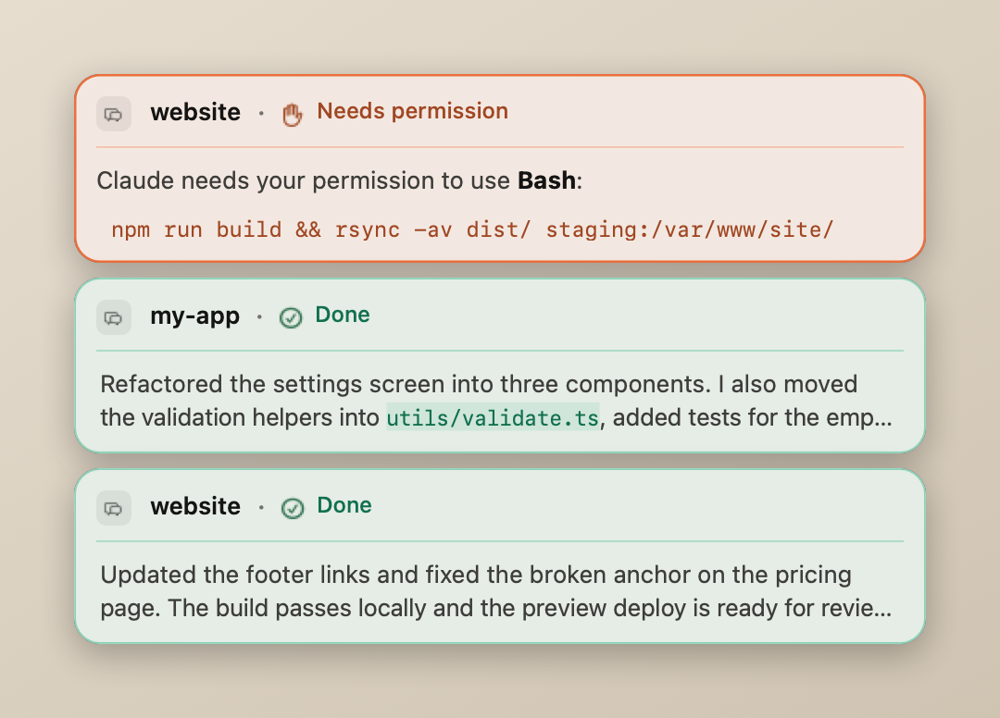
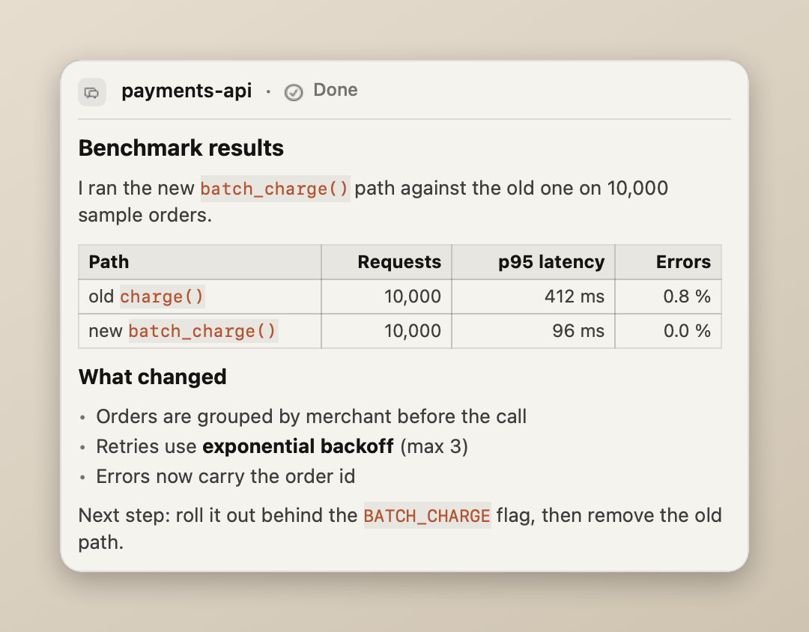
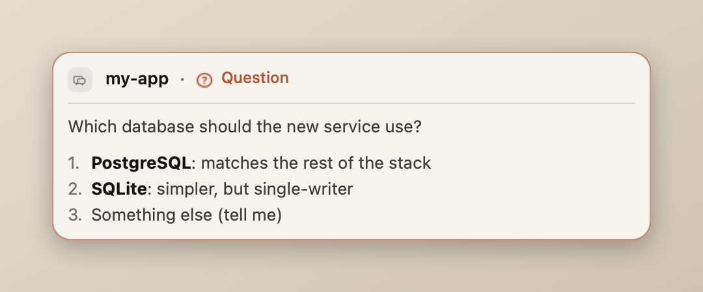
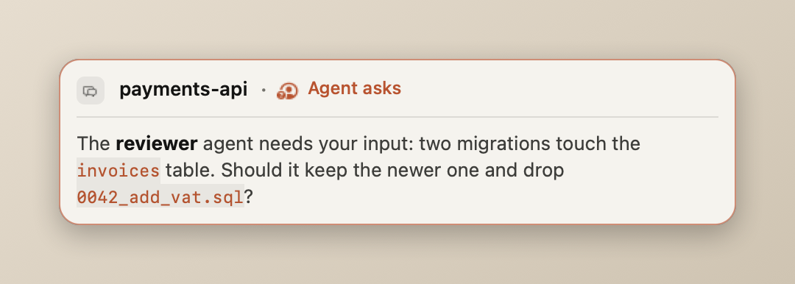
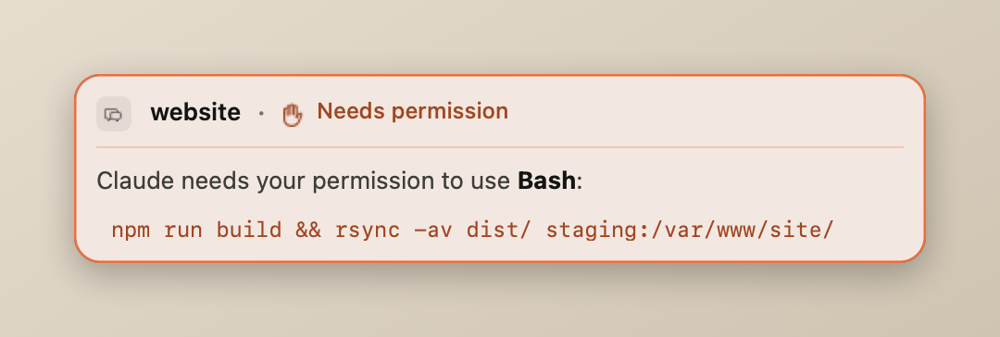
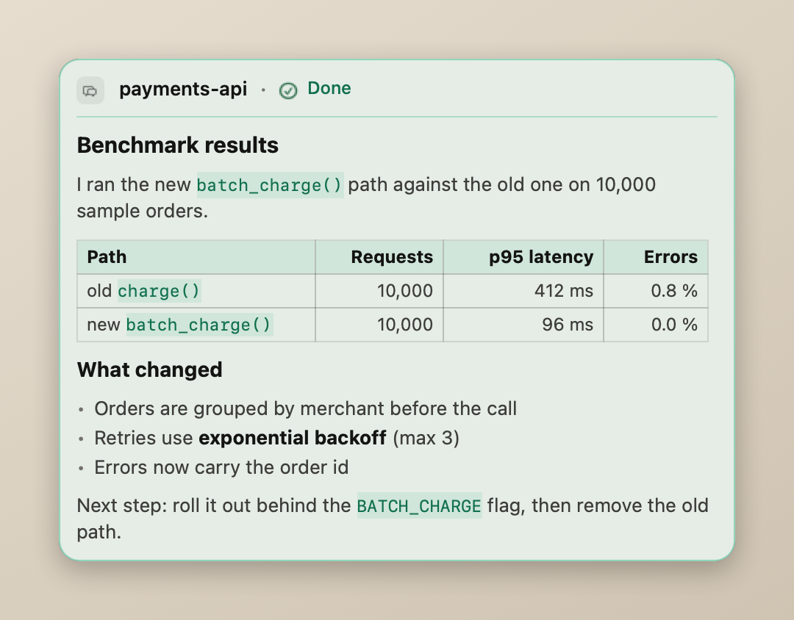
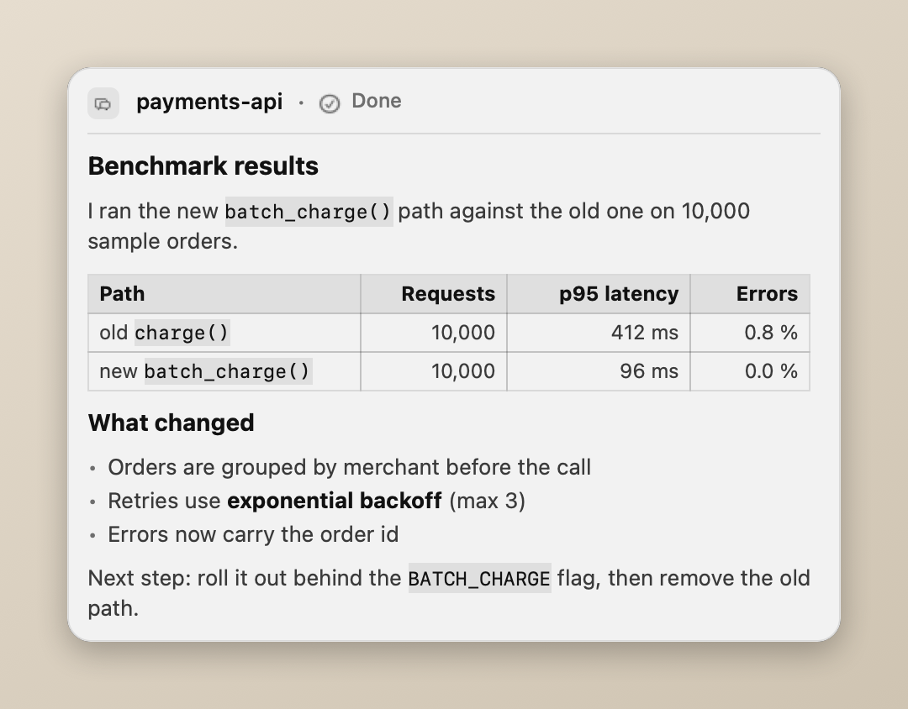
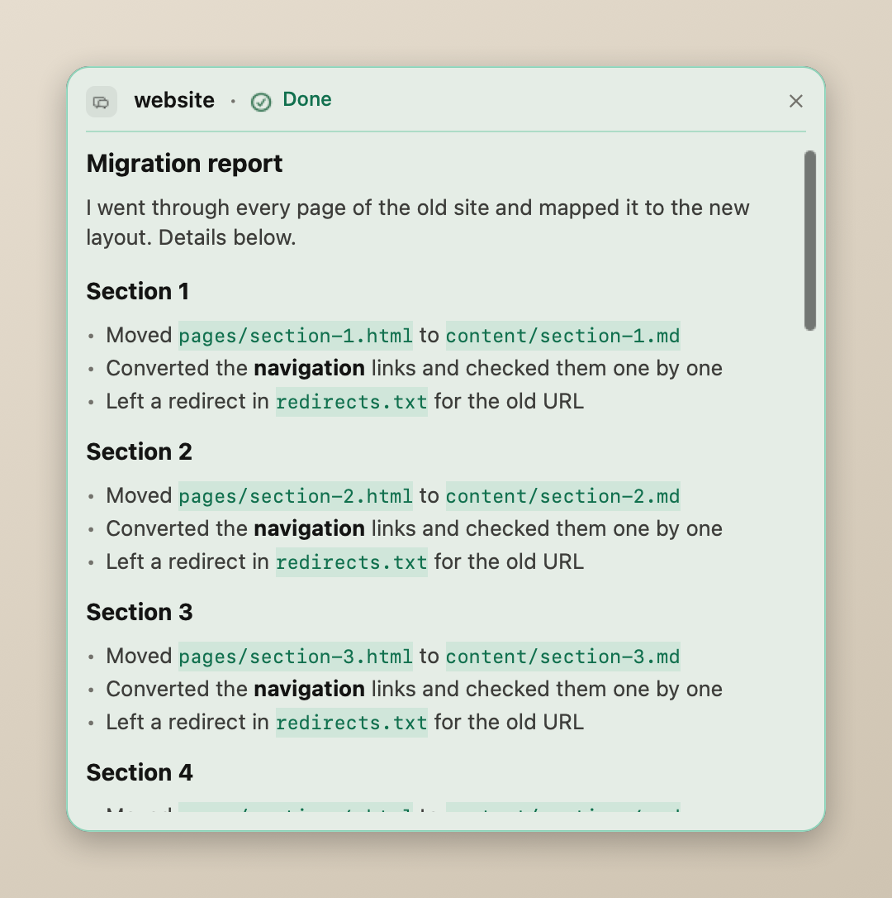
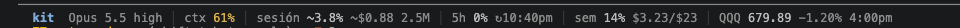

# Claude Code notifications for VS Code on macOS

**English** · [Español](README.es.md)

Know when **[Claude Code](https://docs.claude.com/en/docs/claude-code)** finishes or needs you — without watching the
terminal. A small popup shows Claude's last message, a click takes you to **the exact VS Code terminal** of that
session, and a menu bar icon tracks all your sessions. Local only, built on Claude Code
[hooks](https://docs.claude.com/en/docs/claude-code/hooks).

<p align="center"><picture><source media="(prefers-color-scheme: dark)" srcset="docs/img/popup-stack-dark.png"></picture></p>

> Unofficial community project. Not affiliated with or endorsed by Anthropic. "Claude" is a trademark of Anthropic.

## Contents

1. [What's inside](#whats-inside)
2. [Popups](#1-popups)
3. [Styles](#2-styles)
4. [Long messages and several at once](#3-long-messages-and-several-at-once)
5. [Jump to the exact terminal](#4-jump-to-the-exact-terminal)
6. [Menu bar](#5-menu-bar)
7. [Sounds](#6-sounds)
8. [Status line (optional)](#7-status-line-optional)
9. [Install](#install) · [Configure](#configure) · [Uninstall](#uninstall)
10. [Privacy](#privacy-and-permissions) · [Troubleshooting](#troubleshooting) · [How it works](#how-it-works)

## What's inside

| | Feature | In one line |
|---|---|---|
| 1 | **Popups** | Claude's last message, rendered as Markdown, when it finishes, asks permission, asks a question, or an agent needs you. |
| 2 | **Styles** | `default`, `color` (one hue per kind) or `mono` (grayscale). |
| 3 | **Long messages and stacking** | Long messages scroll; older popups shrink to two lines. |
| 4 | **Jump to the terminal** | Click → the right VS Code window and the exact integrated terminal. |
| 5 | **Menu bar** | Every session at a glance: needs you · wrote to you · thinking. |
| 6 | **Sounds** | A different sound per kind of message, with quiet hours. |
| 7 | **Status line** | Optional one-line status: model, context, session cost, limits. |
| | **Install / uninstall** | One script each; keeps your existing hooks and backs up your settings. |
| | **Languages** | English and Spanish. |

---

## 1. Popups

A translucent card at the top-right of your screen. Each kind of message has its own icon and label. The ones that
**need you** (permission, question, agent) are tinted, have a thin full border, and **stay until you answer**.
"Done" fades after 60 s (paused while you hover or are away).

| Done | Needs permission |
|---|---|
| <picture><source media="(prefers-color-scheme: dark)" srcset="docs/img/popup-style-default-done-dark.png"></picture> | <picture><source media="(prefers-color-scheme: dark)" srcset="docs/img/popup-style-default-permission-dark.png"></picture> |
| **Question** | **A background agent asks** |
| <picture><source media="(prefers-color-scheme: dark)" srcset="docs/img/popup-style-default-question-dark.png"></picture> | <picture><source media="(prefers-color-scheme: dark)" srcset="docs/img/popup-style-default-agent-dark.png"></picture> |

Renders headings, **bold**, *italics*, `code`, code blocks, lists, quotes and real tables with aligned columns.
Images here follow your GitHub light/dark theme; the popup follows macOS.

## 2. Styles

Choose with `"popup": { "style": "default" }` in the [config](#configure).

| `default` | `color` | `mono` |
|---|---|---|
| <picture><source media="(prefers-color-scheme: dark)" srcset="docs/img/popup-style-default-permission-dark.png"></picture> | <picture><source media="(prefers-color-scheme: dark)" srcset="docs/img/popup-style-color-permission-dark.png"></picture> | <picture><source media="(prefers-color-scheme: dark)" srcset="docs/img/popup-style-mono-permission-dark.png"></picture> |
| <picture><source media="(prefers-color-scheme: dark)" srcset="docs/img/popup-style-default-done-dark.png"></picture> | <picture><source media="(prefers-color-scheme: dark)" srcset="docs/img/popup-style-color-done-dark.png"></picture> | <picture><source media="(prefers-color-scheme: dark)" srcset="docs/img/popup-style-mono-done-dark.png"></picture> |
| Neutral card; only messages that need you get the attention color. | One hue per kind: green done, orange permission, blue question, violet agent. | Grayscale only; urgency shows through a filled icon, bold label and stronger border. |

## 3. Long messages and several at once

| Long message → scrolls | Older popups → 2 lines |
|---|---|
| <picture><source media="(prefers-color-scheme: dark)" srcset="docs/img/popup-long-dark.png"></picture> | <picture><source media="(prefers-color-scheme: dark)" srcset="docs/img/popup-compact-dark.png"></picture> |

- Beyond 60 % of the screen height the text scrolls (`max_height_ratio`).
- The newest popup sits on top, open. Older ones shrink to `compact_lines` (2) and expand when you hover.
- A newer popup from the same session replaces the previous one.

## 4. Jump to the exact terminal

Click a popup (or a session in the menu bar):

1. The VS Code window with that project comes to the front.
2. The **integrated terminal running that Claude session** is selected — not just "some" terminal.

It works through a tiny bundled VS Code extension (`ccnotify.focus-terminal`) that matches the terminal's shell to the
Claude process. Works with **VS Code, Insiders, Cursor, Windsurf and VSCodium**. Other hosts (Terminal, iTerm2) are
just brought to the front.

## 5. Menu bar

One icon shows the most urgent state across all sessions:

| Icon state | Meaning |
|---|---|
| Attention color | A session **needs you** (permission, question, agent). |
| Accent color | A session **wrote to you** and you haven't looked yet. |
| Gray | Sessions are **thinking**, or nothing is pending. |

The menu lists each session with its project, state, how long ago, and a one-line summary. Click one to jump to it.
In `mono` style the icon stays gray and the state is shown by its shape.

## 6. Sounds

| Kind | Default sound | When it plays |
|---|---|---|
| Done | Glass (soft) | Only if the turn took more than 15 s **and** VS Code isn't the app in front. |
| Needs permission | Submarine | Always. |
| Question | Ping | Always. |
| Agent asks | Purr | Always. |

- Any sound from `/System/Library/Sounds`, a file in `~/Library/Sounds`, a full path to an audio file, or `""` (silent).
- At most one sound every 3 seconds, and optional **quiet hours** (popups still show).

## 7. Status line (optional)

<p></p>

*A real one, with Spanish labels (`sesión`, `sem`) and the optional ticker turned on. In English it reads:*

```
my-project  Sonnet high │ ctx 52% │ session ~1.2% ~$0.28 45k │ 5h 12% ↻3:00pm │ wk 45% $10.38/$23
```

One quiet gray line at the bottom of Claude Code: project · model · context · this session · 5-hour and weekly limits.
Colors appear only above 40 %. Dollar figures appear only if you set your plan price; an optional market ticker is
**off by default** (it's the only thing that ever uses the network). Details: **[docs/statusline.md](docs/statusline.md)**.

---

## Install

**Requirements:** macOS 12+ (Intel or Apple Silicon), Xcode Command Line Tools (`xcode-select --install`), and Claude
Code used from the **integrated terminal** of VS Code (or Insiders/Cursor/Windsurf/VSCodium).
New to all this? → **[Install Claude Code on a Mac, step by step](docs/install-claude-code-mac.md)**.

```bash
git clone https://github.com/Migentetamoenjapon/claude-code-vscode-notifications.git
cd claude-code-vscode-notifications
./install.sh --statusline      # drop --statusline if you don't want the status line
```

Then **start a new Claude Code session** so it loads the hooks.

| Step | What the installer does |
|---|---|
| 1 | Builds the two small apps from source on your Mac (no downloaded binaries, no Gatekeeper prompts). |
| 2 | Copies everything to `~/.claude/ccnotify/`. |
| 3 | **Adds** its hooks to `~/.claude/settings.json` — your hooks are kept and a dated backup is saved first. |
| 4 | Starts the menu bar app at login (LaunchAgent). |
| 5 | Installs the Focus Terminal extension in every VS Code–family editor it finds. |

Flags: `--dry-run` (show, change nothing) · `--statusline` · `--force` (replace an existing status line) ·
`--universal` (build for Intel + Apple Silicon).

## Configure

Edit `~/.claude/ccnotify/config.json`. Every key is optional ([`config.example.json`](config.example.json) has them
all). Changes apply from the next notification.

```json
{
  "language": "auto",
  "popup":  { "style": "default", "seconds": 60, "width": 460, "max_height_ratio": 0.6,
              "compact_lines": 2, "font_size": 13, "sticky_needs_you": true, "private": false },
  "sounds": {
    "done":       { "sound": "Glass",     "volume": 0.5, "only_when_away": true, "min_turn_seconds": 15 },
    "permission": { "sound": "Submarine", "volume": 0.8 },
    "question":   { "sound": "Ping",      "volume": 0.8 },
    "agent":      { "sound": "Purr",      "volume": 0.7 }
  },
  "quiet_hours": { "enabled": false, "from": "22:00", "to": "07:00" },
  "events": { "done": true, "permission": true, "question": true, "agent": true }
}
```

| Group | Key | What it does |
|---|---|---|
| General | `language` | `auto` (follows macOS), `en` or `es`. |
| Popup look | `style` | `default`, `color` or `mono`. |
| | `width`, `font_size` | Card width (pt) and text size. |
| | `max_height_ratio` | Fraction of the screen height before the text scrolls. |
| | `compact_lines` | Lines kept by older popups in the stack. |
| Popup behavior | `seconds` | When "done" popups fade. |
| | `sticky_needs_you` | Keep permission/question/agent popups until you answer. |
| | `private` | Show only project + kind, never the text. Popups are always hidden from screen sharing. |
| Sounds | `sounds.<kind>` | `sound`, `volume`, `only_when_away`; `done` also has `min_turn_seconds`. |
| | `quiet_hours` | Mute sounds in a time range. |
| Events | `events.<kind>` | Turn a kind of popup off entirely. |
| Status line | `statusline` | See [docs/statusline.md](docs/statusline.md). |

## Uninstall

```bash
./uninstall.sh            # removes hooks, status line (only if ours), apps, LaunchAgent and the extension
./uninstall.sh --purge    # also deletes ~/.claude/ccnotify (config and state)
```

## Privacy and permissions

- **Local only.** No account, no server, no telemetry.
- **What it reads:** the end of the session transcript Claude Code already keeps in `~/.claude/projects/`, to decide
  when to notify. The popup shows Claude's last message.
- **What it stores:** `~/.claude/ccnotify/state/`, private permissions (0700/0600). Queued popups are deleted once shown;
  anything older than an hour is cleaned up. The log never contains message text.
- **macOS permissions:** none. No Accessibility, Screen Recording or Automation.

## Troubleshooting

| Symptom | Fix |
|---|---|
| No popup at all | Start a **new** Claude Code session (hooks load at start). Then read `~/.claude/ccnotify/state/ccnotify.log`. |
| Click doesn't reach the terminal | Make sure the extension is enabled (Extensions → search `ccnotify`). Installed a new editor? Run `./install.sh` again. |
| Claude runs in the VS Code panel, not a terminal | Popups and sounds work; the click brings the window forward, but there's no terminal to select. |
| Too many sounds | Raise `sounds.done.min_turn_seconds`, set `"sound": ""` for a kind, or turn on `quiet_hours`. |

## How it works

```
Claude Code ──hooks──▶ notify.py ──JSON──▶ CCNotify.app (popup) ──click──▶ focus_session.py ──▶ VS Code extension
                          │                                                                    (shows the terminal)
                          └──session state──▶ CCNotify Sessions.app (menu bar)
```

Five hooks (`Stop`, `Notification`, `UserPromptSubmit`, `SessionStart`, `SessionEnd`) call one Python script, which
decides whether to notify; two native Swift apps draw the popup and the menu bar. Design details:
**[docs/ARCHITECTURE.md](docs/ARCHITECTURE.md)** · All screenshots: **[docs/gallery.md](docs/gallery.md)**.

## Contributing

Issues and pull requests welcome. Tests: `python3 -m unittest discover -s tests`. Screenshots:
`tests/render/render_samples.sh`. Keep it dependency-free and local-only.

## License

[MIT](LICENSE)
