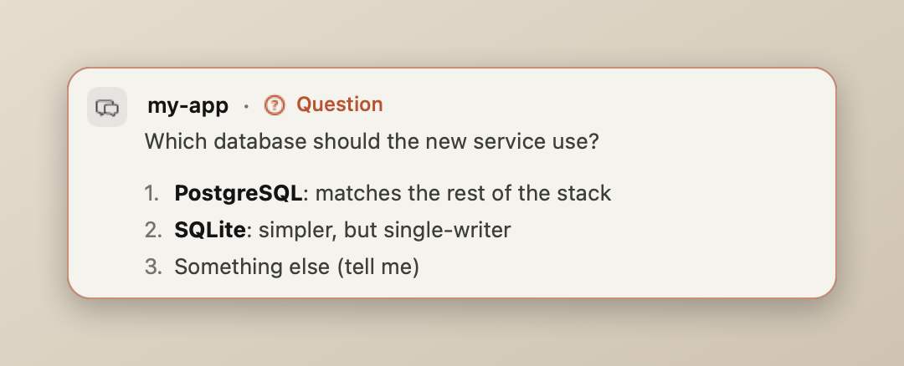

# Claude Code notifications for VS Code on macOS

**[Español](README.es.md)**

Desktop notifications, a menu bar session monitor, per-event sounds and a minimal status line for
**[Claude Code](https://docs.claude.com/en/docs/claude-code) running in the VS Code terminal on macOS**.
When Claude finishes or needs your permission, a small card shows its last message (with real Markdown:
tables, code, lists). Click it and you land in **the exact VS Code terminal** where that session runs.

Built entirely on Claude Code [hooks](https://docs.claude.com/en/docs/claude-code/hooks) and a
[status line](https://docs.claude.com/en/docs/claude-code/statusline) script. Local only: no account, no server,
no telemetry.

> Unofficial community project. Not affiliated with or endorsed by Anthropic. "Claude" is a trademark of Anthropic.

<p align="center">
  
  
</p>
<p align="center">
  
  
</p>

## What you get

| Piece | What it does |
|---|---|
| **Popup** | Translucent card at the top-right when Claude **finishes**, **asks for permission**, **asks a question**, or a **background agent** needs you. Shows the message as Markdown (headings, bold, `code`, lists, real tables) and scrolls when it's long. Each kind has its own icon and label. "Needs you" popups stay until you answer; "done" popups fade after 60 s (paused while you hover or are away). |
| **Jump to the terminal** | Click a popup (or a session in the menu bar) → the right VS Code window comes forward and the **exact integrated terminal** of that session is shown. Works with VS Code, Insiders, Cursor, Windsurf and VSCodium. |
| **Menu bar** | One icon that tells you at a glance if any session needs you (attention), wrote to you (unseen) or is thinking. The menu lists every session with its project and status. |
| **Sounds per event** | A different sound for done / permission / question / agent. The "done" sound only plays if the turn took a while and you're not already looking at VS Code. Quiet hours, custom sound files, at most one sound every 3 s. |
| **Status line** (optional) | One quiet gray line: project · model · context % · session cost · 5-hour and weekly limits. Colors only appear above 40 %. |

## Requirements

- macOS 12 Monterey or newer (Intel or Apple Silicon)
- Xcode Command Line Tools (`xcode-select --install`) — provides `swiftc`, `python3` and `git`
- Claude Code, used from the **integrated terminal** of VS Code (or Insiders/Cursor/Windsurf/VSCodium)

New to all of this? Follow the step-by-step guide: **[Install Claude Code on a Mac](docs/install-claude-code-mac.md)**.

## Install

```bash
git clone https://github.com/Migentetamoenjapon/claude-code-vscode-notifications.git
cd claude-code-vscode-notifications
./install.sh              # add --statusline to also install the status line
```

The installer:

1. Builds the two small apps from source on your Mac (no prebuilt binaries, so no Gatekeeper prompts).
2. Copies everything to `~/.claude/ccnotify/`.
3. **Adds** its hooks to `~/.claude/settings.json` — your existing hooks are kept, and a timestamped backup is saved first.
4. Starts the menu bar app at login (a LaunchAgent).
5. Installs the tiny "Focus Terminal" extension into every VS Code–family editor it finds.

Useful flags: `--dry-run` (show what it would do), `--statusline`, `--force` (replace an existing status line),
`--universal` (build for Intel + Apple Silicon). Restart your Claude Code sessions afterwards so they load the hooks.

## Configure

Edit `~/.claude/ccnotify/config.json` (every key is optional; see [`config.example.json`](config.example.json)).

```json
{
  "language": "auto",
  "popup": { "seconds": 60, "width": 460, "max_height_ratio": 0.6, "font_size": 13,
             "sticky_needs_you": true, "private": false },
  "sounds": {
    "done":       { "sound": "Glass",     "volume": 0.5, "only_when_away": true, "min_turn_seconds": 15 },
    "permission": { "sound": "Submarine", "volume": 0.8 },
    "question":   { "sound": "Ping",      "volume": 0.8 },
    "agent":      { "sound": "Purr",      "volume": 0.7 }
  },
  "quiet_hours": { "enabled": false, "from": "22:00", "to": "07:00" },
  "events": { "done": true, "permission": true, "question": true, "agent": true }
}
```

- **`language`**: `auto` (follows macOS), `en` or `es`.
- **Sounds**: any name from `/System/Library/Sounds` (Basso, Blow, Bottle, Frog, Funk, Glass, Hero, Morse, Ping, Pop,
  Purr, Sosumi, Submarine, Tink), a file you put in `~/Library/Sounds`, an absolute path to an audio file, or `""` for silence.
- **`private`**: show only the project and the kind of message, never the text (handy when presenting).
  Popups are also hidden from screen sharing.
- **`events`**: turn off popups for a kind entirely.

Changes apply to the next notification; no restart needed.

## Status line

`./install.sh --statusline` sets it up. Details, segments and options (plan price to show dollars, optional market
ticker — off by default and the only thing that ever touches the network): **[docs/statusline.md](docs/statusline.md)**.

## Privacy and permissions

- Everything runs locally. Nothing is sent anywhere.
- To decide when to notify, the hook reads the **end** of the session transcript that Claude Code already keeps in
  `~/.claude/projects/`. The popup shows Claude's last message; the menu bar keeps a one-line summary per open session.
- Stored under `~/.claude/ccnotify/state/` with private permissions (folders 0700, files 0600). Queued popups are
  deleted after they're shown (and anything older than an hour is cleaned up). The log never contains message text.
- No special macOS permissions: no Accessibility, no Screen Recording, no Automation.

## Uninstall

```bash
./uninstall.sh            # removes hooks, status line (if it's ours), apps, LaunchAgent and the extension
./uninstall.sh --purge    # also deletes ~/.claude/ccnotify (config and state)
```

## Troubleshooting

- **No popup at all** — restart your Claude Code sessions (hooks load at start). Then check
  `~/.claude/ccnotify/state/ccnotify.log`: every decision is logged (without message text).
- **Click doesn't reach the terminal** — the "Focus Terminal" extension must be enabled in that editor
  (Extensions → search `ccnotify`). Run `./install.sh` again after installing a new editor.
- **Claude runs in the VS Code Claude Code panel, not a terminal** — popups and sounds work; the jump brings the
  window forward but there's no terminal to select.
- **Too many sounds** — raise `sounds.done.min_turn_seconds`, set `"sound": ""` for a kind, or enable `quiet_hours`.

## How it works

Five Claude Code hooks call one small Python script, which decides whether to notify and writes a JSON file; a native
Swift app shows it. Details, file layout and design decisions: **[docs/ARCHITECTURE.md](docs/ARCHITECTURE.md)**.

## Contributing

Issues and pull requests are welcome. Run the tests with `python3 -m unittest discover -s tests` and render the
popup samples with `tests/render/render_samples.sh`. Please keep it dependency-free and local-only.

## License

[MIT](LICENSE)
