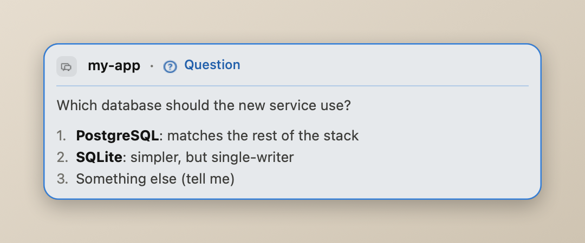
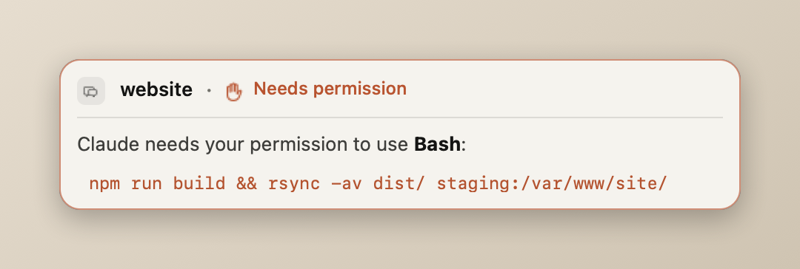
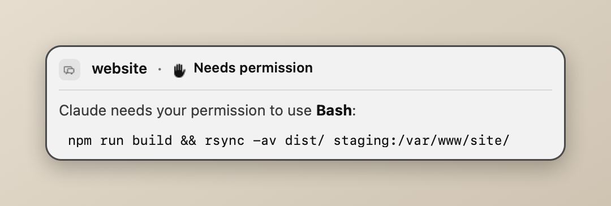
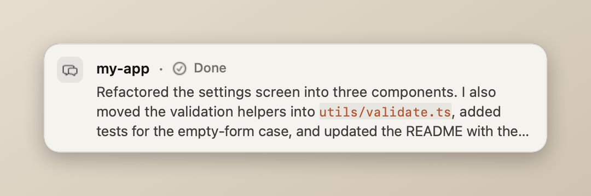
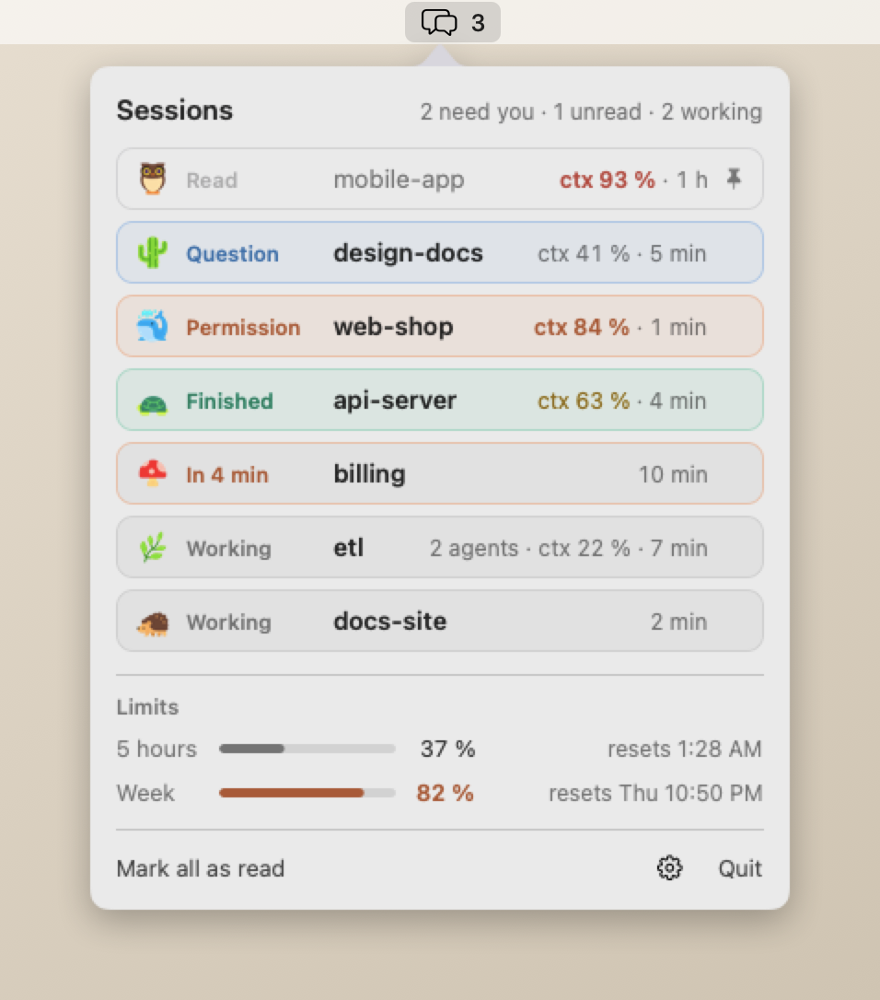
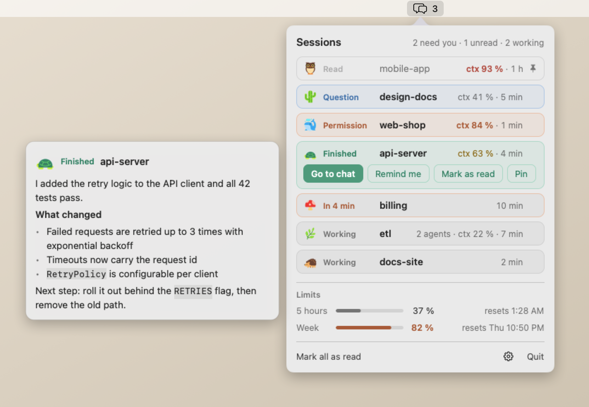
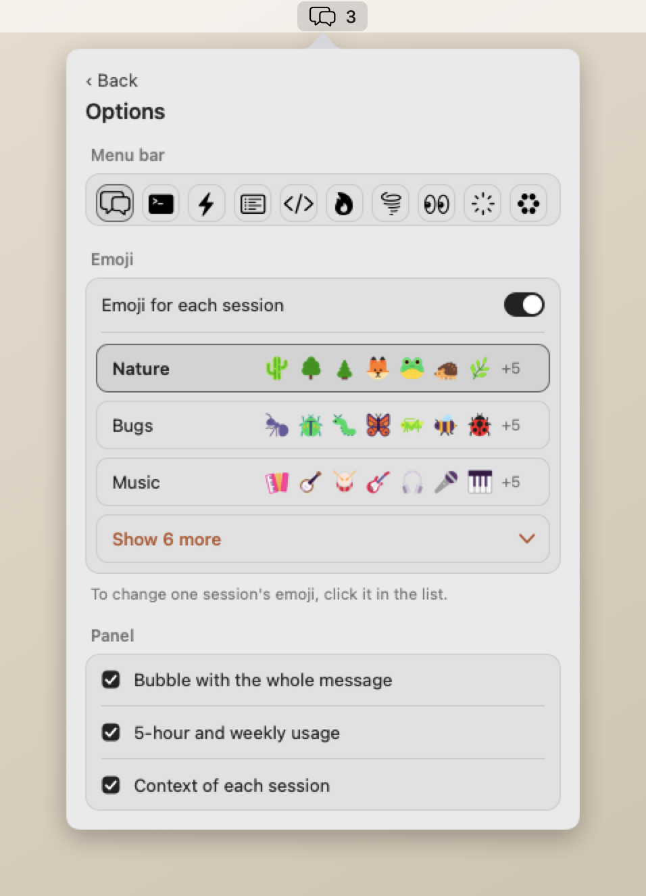
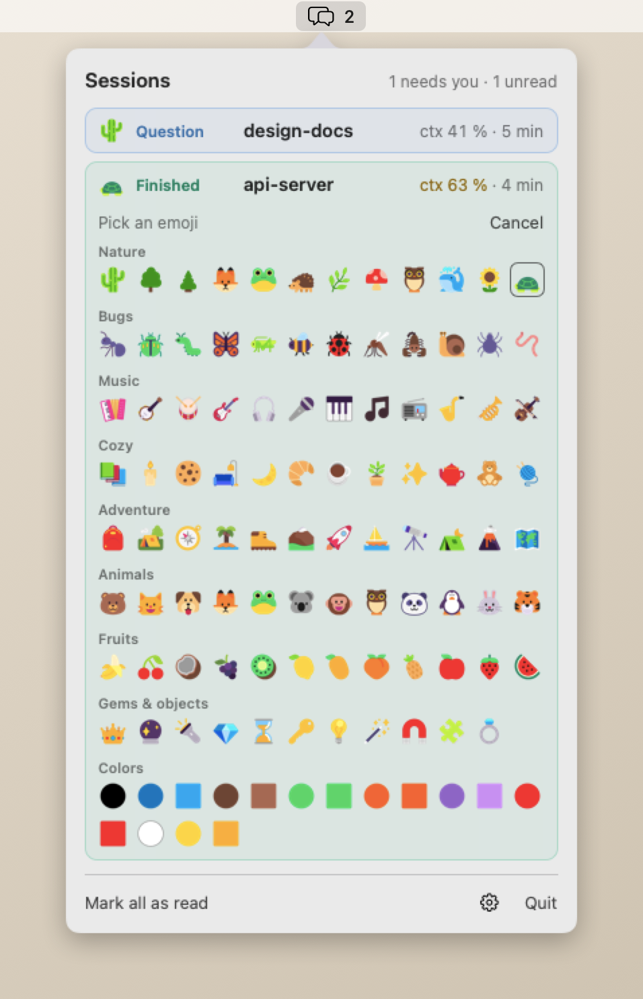

# Claude Code notifications for VS Code on macOS

**English** · [Español](README.es.md)

Know when **[Claude Code](https://docs.claude.com/en/docs/claude-code)** finishes or needs you — without watching the
terminal. A small popup shows Claude's last message, a click takes you to **the exact VS Code terminal** of that
session, and a menu bar icon tracks all your sessions. Local only, built on Claude Code
[hooks](https://docs.claude.com/en/docs/claude-code/hooks).

<p align="center"><picture><source media="(prefers-color-scheme: dark)" srcset="docs/img/popup-stack-dark.png"></picture></p>

> Unofficial community project. Not affiliated with or endorsed by Anthropic. "Claude" is a trademark of Anthropic.

Free to use, change and share however you like (MIT). I built this while learning, so any feedback is welcome:
ideas, bug reports, or "this could be simpler" — just [open an issue](../../issues).

## Start here

| If you… | Go to |
|---|---|
| **Have never used Claude Code** | **[Set up Claude Code in VS Code on a Mac, step by step](docs/install-claude-code-mac.md)** — from zero: the account, VS Code, Claude Code, your first conversation, and this kit at the end. About 30 minutes, no terminal experience needed. |
| **Already use Claude Code in VS Code** | **[Install](#install)** — three lines in the terminal. |

Wondering why VS Code and not the Claude desktop app? See [Why VS Code](#why-vs-code).

## Contents

1. [Start here](#start-here) — the step-by-step setup guide
2. [What's inside](#whats-inside) · [Why VS Code](#why-vs-code)
3. [Popups](#1-popups)
4. [Styles](#2-styles)
5. [Long messages and several at once](#3-long-messages-and-several-at-once)
6. [Jump to the exact terminal](#4-jump-to-the-exact-terminal)
7. [Menu bar](#5-menu-bar)
8. [Sounds](#6-sounds)
9. [Status line](#7-status-line)
10. [Install](#install) · [Pick what you want](#pick-what-you-want) · [Configure](#configure) · [Uninstall](#uninstall)
11. [Privacy](#privacy-and-permissions) · [Troubleshooting](#troubleshooting) · [How it works](#how-it-works)

## What's inside

| | Feature | In one line |
|---|---|---|
| 1 | **Popups** | Claude's last message, rendered as Markdown, when it finishes, asks permission, asks a question, or an agent needs you. |
| 2 | **Styles** | `color` (one hue per kind, the default), `neutral` or `mono` (grayscale). |
| 3 | **Long messages and stacking** | Long messages scroll; older popups shrink to two lines. |
| 4 | **Jump to the terminal** | Click → the right VS Code window and the exact integrated terminal. |
| 5 | **Menu bar** | Every session in one panel, most relevant first: hover for actions and the whole message, pin, remind me later, limits, optional emoji per session. |
| 6 | **Sounds** | A different sound per kind of message, with quiet hours. |
| 7 | **Status line** | One quiet line at the bottom of Claude Code: model, context, session cost, limits. |
| | **Install / uninstall** | One script each; keeps your existing hooks and backs up your settings. |
| | **Languages** | English and Spanish. |

**Every piece is optional**: take only the ones you want — see [Pick what you want](#pick-what-you-want).

## Why VS Code

On a Mac, the three usual ways to use Claude Code are the Claude desktop app, the Claude panel of the VS Code
extension, and the `claude` command in a terminal. This kit is built for the third, in VS Code's integrated terminal.
The desktop app and the terminal share one engine, the same settings and the same hooks, and both run several
conversations in parallel. This is where they differ:

| | In the VS Code terminal | In the Claude desktop app |
|---|---|---|
| **1. Claude is a command** | You type `claude` in a terminal, so it can also be part of something bigger: a script, a scheduled job, or a chain like `git diff \| claude -p "review this change"`. The same command works on a server over SSH. | Interactive only: you talk to it in a window and it cannot be called from a script. It has scheduled tasks and SSH sessions, set up from its own screens. |
| **2. Command-line-only features** | Agent teams (several Claude sessions coordinated on one task), the `dontAsk` permission mode (only what you already approved runs, with no prompts) and `/permissions` to edit permission rules from the conversation. | No agent teams and no `dontAsk`. The permission mode is picked from a selector and `/permissions` does not work there: rules are edited in the settings. |
| **3. Status line and background sessions** | A status line you define yourself at the bottom of the terminal, and `claude agents` to see and open the sessions running in the background. | The model picker and the list of sessions are part of the app's interface; a custom status line is only documented for the terminal. |
| **4. Jump to the exact conversation** | Each conversation is a terminal tab, and VS Code lets an extension find that tab and bring it to the front. That is why a click on one of this kit's popups lands on the right conversation. | The app shows its own notification when a session finishes. There is no terminal tab for this kit to jump to. |

The desktop app has strengths of its own (visual review of changes, a browser pane, sessions in the cloud) and can
work on the same project at the same time.

---

## 1. Popups

A translucent card at the top-right of your screen. Each kind of message has its own icon, label and hue. The ones that
**need you** (permission, question, agent) get a stronger border and **stay until you answer**.
"Done" fades after 60 s (paused while you hover or are away).

| Done | Needs permission |
|---|---|
| <picture><source media="(prefers-color-scheme: dark)" srcset="docs/img/popup-style-color-done-dark.png"></picture> | <picture><source media="(prefers-color-scheme: dark)" srcset="docs/img/popup-style-color-permission-dark.png"></picture> |
| **Question** | **A background agent asks** |
| <picture><source media="(prefers-color-scheme: dark)" srcset="docs/img/popup-style-color-question-dark.png"></picture> | <picture><source media="(prefers-color-scheme: dark)" srcset="docs/img/popup-style-color-agent-dark.png"></picture> |

Renders headings, **bold**, *italics*, `code`, code blocks, lists, quotes and real tables with aligned columns.
Images here follow your GitHub light/dark theme; the popup follows macOS.

## 2. Styles

Choose with `"popup": { "style": "color" }` in the [config](#configure).

| `color` (default) | `neutral` | `mono` |
|---|---|---|
| <picture><source media="(prefers-color-scheme: dark)" srcset="docs/img/popup-style-color-permission-dark.png"></picture> | <picture><source media="(prefers-color-scheme: dark)" srcset="docs/img/popup-style-neutral-permission-dark.png"></picture> | <picture><source media="(prefers-color-scheme: dark)" srcset="docs/img/popup-style-mono-permission-dark.png"></picture> |
| <picture><source media="(prefers-color-scheme: dark)" srcset="docs/img/popup-style-color-done-dark.png"></picture> | <picture><source media="(prefers-color-scheme: dark)" srcset="docs/img/popup-style-neutral-done-dark.png"></picture> | <picture><source media="(prefers-color-scheme: dark)" srcset="docs/img/popup-style-mono-done-dark.png"></picture> |
| One hue per kind: green done, orange permission, blue question, violet agent. | Neutral card; only messages that need you get the attention color. | Grayscale only; urgency shows through a filled icon, bold label and stronger border. |

## 3. Long messages and several at once

| Long message → scrolls | Older popups → 2 lines |
|---|---|
| <picture><source media="(prefers-color-scheme: dark)" srcset="docs/img/popup-long-dark.png"></picture> | <picture><source media="(prefers-color-scheme: dark)" srcset="docs/img/popup-compact-dark.png"></picture> |

- Beyond 60 % of the screen height the text scrolls (`max_height_ratio`).
- The newest popup sits on top, open. Older ones shrink to `compact_lines` (2) and expand when you hover.
- A newer popup from the same session replaces the previous one.

## 4. Jump to the exact terminal

Click a popup (or a session in the menu bar):

1. The VS Code window with that project comes to the front.
2. The **integrated terminal running that Claude session** is selected — not just "some" terminal.

It works through a tiny bundled VS Code extension (`ccnotify.focus-terminal`) that matches the terminal's shell to the
Claude process. **Background sessions** (`claude --bg`) have no terminal of their own, so for those the click opens a
terminal running `claude attach <id>` — straight into that conversation — and reuses it for as long as it is still on that conversation. Clicking also works when the session is shown in Claude Code's agent view (`claude agents`): one window opens the conversation in a new tab. Works with **VS Code, Insiders, Cursor, Windsurf and VSCodium**. Other hosts (Terminal, iTerm2) are
just brought to the front.

## 5. Menu bar

<p align="center"><picture><source media="(prefers-color-scheme: dark)" srcset="docs/img/menubar-dark.png"></picture></p>

The menu bar icon (two speech bubbles by default) counts what is waiting for you: sessions that need you plus finished
ones you haven't looked at. No number means nothing is pending. Click it for one list with a box per open session,
**most relevant first**: pinned · needs you · finished, unread · reminder pending · working · read.

- Each row shows the state, the project and, on the right, `2 agents · ctx 62 % · 3 min`: agents still running, how
  full the context is, and how long it has been in this state.
- Click a row to [jump to that session's terminal](#4-jump-to-the-exact-terminal).
- Rest the mouse on a row and it opens: **Go to chat** · **Remind me** (in 2, 5 or 15 min; the popup comes back when it
  is due) · **Mark as read** · **Pin** (keeps it on top).
- Keep resting and a bubble with the whole last message appears beside the panel (not with `"popup": { "private": true }`).

<p align="center"><picture><source media="(prefers-color-scheme: dark)" srcset="docs/img/menubar-bubble-dark.png"></picture></p>

- **Limits** at the bottom: the 5-hour and weekly usage, with a bar and when each resets. Together with the `ctx` of
  each row it comes from the [status line](#7-status-line); without it you get neither.
- **Mark all as read** clears the unread ones. A session leaves the list when you close it. The app starts by itself
  when you log in.

**Options.** The gear next to Quit opens a page for what the panel shows and how it looks: the **icon** of the menu bar
item, **emoji** for each session, and whether to show the message bubble, the usage limits and the context of each
session. Your choices are saved in `state/menubar/options.json` (the app's own file; `config.json` is never touched).

**An emoji for each session.** Every open session gets its own small picture (on by default; the switch is on the options page), from a family you
choose (nature, bugs, music, cozy, adventure, animals, fruits, gems & objects, colors) and different from the other open ones,
so you tell your sessions apart at a glance. Click the emoji in a row to pick another one yourself, or go back to
*Automatic*. The pictures are [Fluent Emoji](https://github.com/microsoft/fluentui-emoji) by Microsoft (MIT).

<p align="center"><picture><source media="(prefers-color-scheme: dark)" srcset="docs/img/menubar-options-dark.png"></picture> <picture><source media="(prefers-color-scheme: dark)" srcset="docs/img/menubar-picker-dark.png"></picture></p>

In `mono` style nothing is colored (the emoji turn gray too).

<p align="center"><picture><source media="(prefers-color-scheme: dark)" srcset="docs/img/menubar-mono-dark.png"></picture></p>

## 6. Sounds

| Kind | Default sound | When it plays |
|---|---|---|
| Done | Glass (soft) | Only if the turn took more than 15 s **and** VS Code isn't the app in front. |
| Needs permission | Submarine | Always. |
| Question | Ping | Always. |
| Agent asks | Purr | Always. |

- Any sound from `/System/Library/Sounds`, a file in `~/Library/Sounds`, a full path to an audio file, or `""` (silent).
- At most one sound every 3 seconds, and optional **quiet hours** (popups still show).

## 7. Status line

<p align="center"><picture><source media="(prefers-color-scheme: dark)" srcset="docs/img/statusline-dark.png"></picture></p>

One quiet gray line at the bottom of Claude Code. A number takes a color only when it passes 40 %.

| Segment | Meaning |
|---|---|
| `my-project  Sonnet high` | Project folder, model and reasoning effort. |
| `ctx 52%` | How full the context window is. |
| `session ~1.2% ~$0.28 45k` | This session only: its share of your weekly limit, that share in plan dollars, tokens used. |
| `5h 12% ↻3:00pm` | 5-hour limit used, and when it resets. |
| `wk 45% $10.38/$23` | Weekly limit used, also in plan dollars. |

Dollar figures appear only if you set your plan price. An optional market ticker is **off by default** (it's the only
thing in this kit that ever uses the network). Details: **[docs/statusline.md](docs/statusline.md)**.

---

## Install

**Requirements:** macOS 12+ (Intel or Apple Silicon), Xcode Command Line Tools (`xcode-select --install`), and Claude
Code used from the **integrated terminal** of VS Code (or Insiders/Cursor/Windsurf/VSCodium).

> Don't have Claude Code yet, or never used a terminal? Follow
> **[Set up Claude Code in VS Code on a Mac, step by step](docs/install-claude-code-mac.md)** first — it ends with this install.

```bash
git clone https://github.com/Migentetamoenjapon/claude-code-vscode-notifications.git
cd claude-code-vscode-notifications
./install.sh --statusline
```

Then **start a new Claude Code session** so it loads the hooks.

| Step | What the installer does |
|---|---|
| 1 | Builds the two small apps from source on your Mac (no downloaded binaries, no Gatekeeper prompts). |
| 2 | Copies everything to `~/.claude/ccnotify/`. |
| 3 | **Adds** its hooks to `~/.claude/settings.json` — your hooks are kept and a dated backup is saved first. |
| 4 | Starts the menu bar app at login (LaunchAgent). |
| 5 | Installs the Focus Terminal extension in every VS Code–family editor it finds. |

Other flags: `--dry-run` (show, change nothing) · `--force` (replace a status line you already have) ·
`--universal` (build for Intel + Apple Silicon).

### Pick what you want

Every piece is optional. The flags apply when you install; the config keys apply from the next notification.

| Piece | To leave it out |
|---|---|
| Popups | `"popup": { "enabled": false }` in the config — or turn off one kind with `"events": { "done": false }`. |
| Sounds | `"sound": ""` for that kind in the config. |
| Jump to the terminal | Install with `--skip-extension` (the click then only brings the editor to the front). |
| Menu bar | Install with `--skip-launchagent` (the menu bar app is not started). |
| Status line | Install without `--statusline`. |

## Configure

Edit `~/.claude/ccnotify/config.json`. Every key is optional ([`config.example.json`](config.example.json) has them
all). Changes apply from the next notification.

```json
{
  "language": "auto",
  "popup":  { "style": "color", "seconds": 60, "width": 460, "max_height_ratio": 0.6,
              "compact_lines": 2, "font_size": 13, "sticky_needs_you": true, "private": false },
  "sounds": {
    "done":       { "sound": "Glass",     "volume": 0.5, "only_when_away": true, "min_turn_seconds": 15 },
    "permission": { "sound": "Submarine", "volume": 0.8 },
    "question":   { "sound": "Ping",      "volume": 0.8 },
    "agent":      { "sound": "Purr",      "volume": 0.7 }
  },
  "quiet_hours": { "enabled": false, "from": "22:00", "to": "07:00" },
  "events": { "done": true, "permission": true, "question": true, "agent": true },
  "project_names": {}
}
```

| Group | Key | What it does |
|---|---|---|
| General | `language` | `auto` (follows macOS), `en` or `es`. |
| | `project_names` | Rename a project in popups, the menu bar, the status line and the terminal tab: folder name → label, e.g. `{ "long-repository-name": "repo" }`. Sessions in a Claude Code worktree (`<project>/.claude/worktrees/<name>`) already show the project's name, not the worktree's, with no setting needed. |
| Popup look | `style` | `color` (default), `neutral` or `mono`. Anything else falls back to `color`. |
| | `width`, `font_size` | Card width (pt) and text size. |
| | `max_height_ratio` | Fraction of the screen height before the text scrolls. |
| | `compact_lines` | Lines kept by older popups in the stack. |
| Popup behavior | `seconds` | When "done" popups fade. |
| | `sticky_needs_you` | Keep permission/question/agent popups until you answer. |
| | `private` | Show only project + kind, never the text. Popups are always hidden from screen sharing. |
| Sounds | `sounds.<kind>` | `sound`, `volume`, `only_when_away`; `done` also has `min_turn_seconds`. |
| | `quiet_hours` | Mute sounds in a time range. |
| Events | `events.<kind>` | Turn a kind of popup off entirely. |
| Status line | `statusline` | See [docs/statusline.md](docs/statusline.md). |

## Uninstall

```bash
./uninstall.sh            # removes hooks, status line (only if ours), apps, LaunchAgent and the extension
./uninstall.sh --purge    # also deletes ~/.claude/ccnotify (config and state)
```

## Privacy and permissions

- **Local only.** No account, no server, no telemetry.
- **What it reads:** the end of the session transcript Claude Code already keeps in `~/.claude/projects/`, to decide
  when to notify. The popup shows Claude's last message.
- **What it stores:** `~/.claude/ccnotify/state/`, private permissions (0700/0600). Queued popups are deleted once shown;
  anything older than an hour is cleaned up. The log never contains message text.
- **macOS permissions:** none. No Accessibility, Screen Recording or Automation.

## Troubleshooting

| Symptom | Fix |
|---|---|
| No popup at all | Start a **new** Claude Code session (hooks load at start). Then read `~/.claude/ccnotify/state/ccnotify.log`. |
| Click doesn't reach the terminal | Make sure the extension is enabled (Extensions → search `ccnotify`). Installed a new editor? Run `./install.sh` again. After updating the extension, reload the editor window (Developer: Reload Window). |
| Claude runs in the VS Code panel, not a terminal | Popups and sounds work; the click brings the window forward, but there's no terminal to select. |
| Too many sounds | Raise `sounds.done.min_turn_seconds`, set `"sound": ""` for a kind, or turn on `quiet_hours`. |

## How it works

```
Claude Code ──hooks──▶ notify.py ──JSON──▶ CCNotify.app (popup) ──click──▶ focus_session.py ──▶ VS Code extension
                          │                                                                    (shows the terminal)
                          └──session state──▶ CCNotify Sessions.app (menu bar)
```

Five hooks (`Stop`, `Notification`, `UserPromptSubmit`, `SessionStart`, `SessionEnd`) call one Python script, which
decides whether to notify; two native Swift apps draw the popup and the menu bar. Design details:
**[docs/ARCHITECTURE.md](docs/ARCHITECTURE.md)** · All screenshots: **[docs/gallery.md](docs/gallery.md)**.

## Contributing

Issues and pull requests welcome, small ones included. Tests: `python3 -m unittest discover -s tests`. Screenshots:
`tests/render/render_samples.sh`. Keep it dependency-free and local-only.

## License

[MIT](LICENSE). The per-session emoji in `assets/emoji/` are [Fluent Emoji](https://github.com/microsoft/fluentui-emoji) by Microsoft (Flat style, MIT): see [assets/emoji/LICENSE](assets/emoji/LICENSE).
